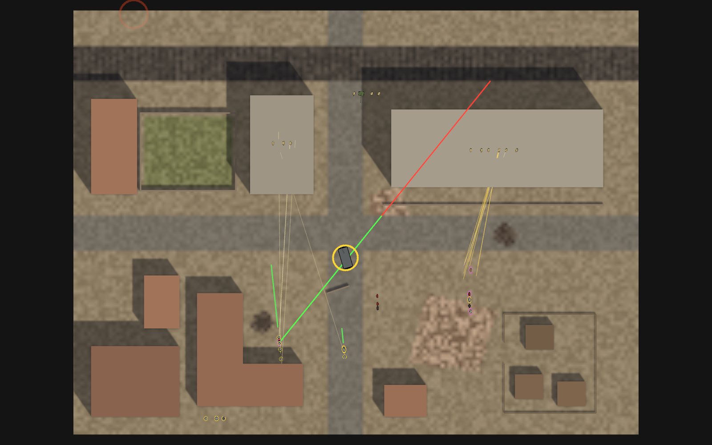

# Close Fight

一款以 1942 年斯大林格勒战役为背景的即时战术游戏（RTS），灵感来自经典的 Close Combat 系列：俯视视角，指挥有名有姓的士兵小组，每个士兵都会害怕、恐慌，也会在战火中成长。

**当前阶段**：设计已完成，正在开发雏形。雏形是火车站一带的一场完整战斗：玩家扮演德军进攻，AI 扮演苏军防守。

**雏形进度**（详见 [雏形开发计划](docs/design/prototype-plan.md)）：
- ✅ M0 项目框架：Unity 6.6 + URP，模拟核心与画面分离，自动化测试
- 🔶 M1 地图：由 JSON 数据生成地形、建筑和墙，俯视镜头
- 🔶 M2 小组与移动：CC 式右键命令、点选和框选、寻路、行进纵队与展开
- 🔶 M3 视线与迷雾：建筑按最高层算视野、发现距离、声音标记、视线工具
- 🔶 M4 射击与压制：6 种武器、命中与伤亡、压制与钉住、弹药、烟雾
- 🔶 M5 心理模型：士气与压制、恐慌和溃逃、伤亡过半请求撤退、拒绝命令并显示原因
- 🔶 M6 载具与火炮：装甲按角度计算、乘员弃车、高爆弹炸楼、迫击炮间接射击、步兵近身反坦克
- ⬜ M7 防守 AI → M8 火车站地图与胜负

**引擎**：Unity 6（C#，URP）

## 文档

**设计**
- [游戏设计文档](docs/design/GAME_DESIGN.md)：按系统整理的全部设计决定
- [雏形开发计划](docs/design/prototype-plan.md)：技术架构和里程碑
- [设计问答记录](docs/design/design-qa.md)：8 轮问答的完整过程（D1–D52）
- [技术路线：地图、美术与引擎](docs/design/tech-map-art-pipeline.md)
- [美术资产清单](docs/design/art-asset-list.md)
- [给 Codex 的出图需求](docs/art/codex/README.md)：一个动画一个文件、一个对话

**调研**
- [Close Combat 机制调研](docs/research/close-combat-mechanics.md)
- [斯大林格勒战役背景](docs/research/stalingrad-background.md)
