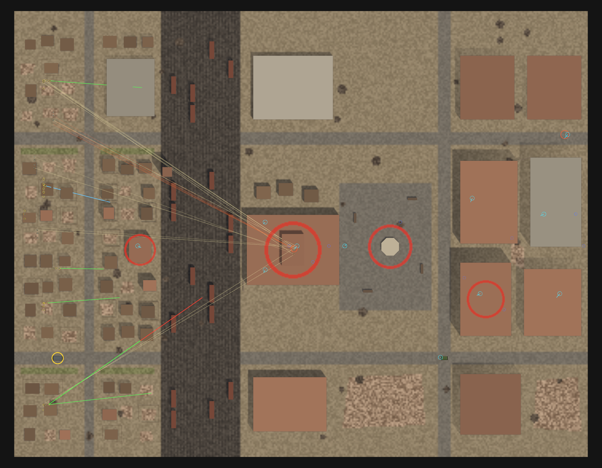

# Close Fight

一款以 1942 年斯大林格勒战役为背景的即时战术游戏（RTS），灵感来自经典的 Close Combat 系列：俯视视角，指挥有名有姓的士兵小组，每个士兵都会害怕、恐慌，也会在战火中成长。

**当前阶段**：雏形的 8 个里程碑都已完成第一版，等待试玩和调整。雏形是火车站一带的一场完整战斗：玩家扮演德军进攻，AI 扮演苏军防守。第二阶段已经开始（见[计划第 6 节](docs/design/prototype-plan.md)）：已有开战前的简报和部署，坦克和火炮已经换上 Codex 画的俯视图，进攻方 AI 也有了第一版，可以选苏军防守。

**雏形进度**（详见 [雏形开发计划](docs/design/prototype-plan.md)）：
- ✅ M0 项目框架：Unity 6.6 + URP，模拟核心与画面分离，自动化测试
- 🔶 M1 地图：由 JSON 数据生成地形、建筑和墙，俯视镜头
- 🔶 M2 小组与移动：CC 式右键命令、点选和框选、寻路、行进纵队与展开
- 🔶 M3 视线与迷雾：建筑按最高层算视野、发现距离、声音标记、视线工具
- 🔶 M4 射击与压制：6 种武器、命中与伤亡、压制与钉住、弹药、烟雾
- 🔶 M5 心理模型：士气与压制、恐慌和溃逃、伤亡过半请求撤退、拒绝命令并显示原因
- 🔶 M6 载具与火炮：装甲按角度计算、乘员弃车、高爆弹炸楼、迫击炮间接射击、步兵近身反坦克
- 🔶 M7 防守 AI：阵地分析、交叉火力、第二道阵地、按姿态后撤、预备队反冲击，AI 只用本方情报（不作弊）
- 🔶 M8 火车站地图与胜负：斯大林格勒第一火车站地图、目标点、全军士气与停火、战后统计、地图编辑器

**第二阶段**：
- 🔶 M9 开战前的简报和部署、Codex 美术接入、性能优化、Mac 独立版本、触控板操作
- 🔶 M10 进攻方 AI：集结、交替跃进、火力压制、烟幕、侧翼冲锋，只用自己看到的情报
- 🔶 M12 狙击手和工兵：狙击手专打军官和机枪手；工兵炸墙炸楼、喷火、布雷排雷
- 🔶 M13 场外支援：炮兵、喀秋莎、斯图卡，要观察员看得到目标，1–3 分钟后落下，不分敌我
- 🔶 M14 夜战和照明弹：夜里只在近处才看得到人，开枪会暴露；照明弹随风飘、慢慢下降，照亮一片地方；新剧本「9 月 15 日夜：近卫军反击车站」

## 试玩

**Mac 独立版本（推荐，比在编辑器里跑轻得多）**：在 Unity 菜单点 **Close Fight → Build macOS App**，生成 `Builds/macOS/Close Fight.app`，双击打开。

**在编辑器里**：

1. 用 Unity Hub 打开项目（Unity 6.6），打开 `Assets/CloseFight/Scenes/Battle.unity`，点 Play。
2. 先看简报，选择阵营；然后在黄色部署区里摆好部队，按 Enter 开战。
   - 选德军：你指挥第 71 步兵师从西边进攻火车站，苏军 AI 防守。
   - 选苏军：你守车站，德军 AI 会侦察、压制、放烟幕、迂回，再集中兵力突破。
3. 操作说明见 [雏形开发计划](docs/design/prototype-plan.md) 3.1 节；调整地图见 3.2 节。

**笔记本没有鼠标**：右键用双指点按或 Ctrl + 单击。点顶栏的「触控板：开」后，双指滑动平移地图，按住 Cmd 再滑动缩放。顶栏的「60 FPS / 30 FPS」可以切换帧率上限，30 帧更省电。

**引擎**：Unity 6（C#，URP）

## 文档

**设计**
- [游戏设计文档](docs/design/GAME_DESIGN.md)：按系统整理的全部设计决定
- [雏形开发计划](docs/design/prototype-plan.md)：技术架构和里程碑
- [设计问答记录](docs/design/design-qa.md)：8 轮问答的完整过程（D1–D52）
- [技术路线：地图、美术与引擎](docs/design/tech-map-art-pipeline.md)
- [美术资产清单](docs/design/art-asset-list.md)
- [给 Codex 的出图需求](docs/art/codex/README.md)：一个动画一个文件、一个对话

**调研**
- [Close Combat 机制调研](docs/research/close-combat-mechanics.md)
- [斯大林格勒战役背景](docs/research/stalingrad-background.md)
