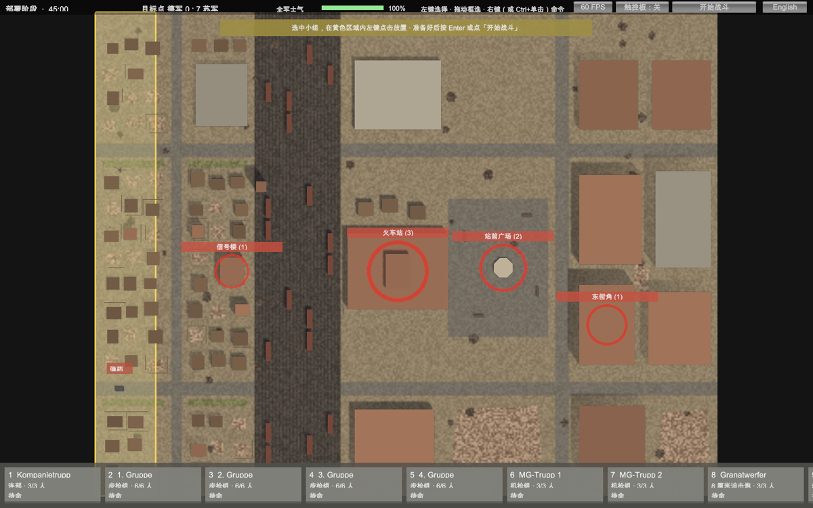

# 雏形开发计划

> 依据：[GAME_DESIGN.md](GAME_DESIGN.md) 第 10 节，以及 [design-qa.md](design-qa.md) 的 D47–D52。
> 版本：v1（2026-11-22）

## 1. 雏形是什么

- **一场完整的战斗**：从部署打到战后结算。
- **地图**：斯大林格勒中央火车站一带，约 500 × 500 米。时间是 1942 年 9 月 14–15 日。
- **兵力**：连对连，每方约 8–12 个小组。
- **阵营**：玩家扮演德军（第 71 步兵师一部）进攻火车站，AI 扮演苏军防守。
- **美术**：先用我画的占位图，Codex 的图出来后再替换。
- **完成的标准**：能和 AI 从头打到尾，打完看到战后统计。达到这个标准后推上 GitHub。

## 2. 技术架构

### 2.1 引擎版本

- Unity **6000.6.10f1**（Unity 6.6），URP 渲染管线。
- 6.7 LTS 正式发布后再升级。

### 2.2 目录结构

```
Assets/CloseFight/
  Core/            模拟核心：纯 C#，只用引擎的数学模块（CloseFight.Core）
  Game/            画面、输入、界面（CloseFight.Game，引用 Core）
  Editor/          地图编辑器等编辑器工具（CloseFight.Editor）
  Tests/EditMode/  Core 的自动化测试（CloseFight.Tests）
  Data/            武器、单位、地图数据（JSON）
  Localization/    中英翻译表
```

> **注意（2026-11-22）**：Unity 6.6 把 Unity.Mathematics 并进了引擎模块（UnityEngine.MathematicsModule），所以 Core 的程序集没法再设成"完全不引用引擎"。现在的做法是允许引用，再用测试 `CoreIsolationTests` 保证 Core 除了数学模块不碰任何引擎代码。

### 2.3 关键原则

1. **模拟和画面分离**。
   - 战斗模拟全部放在 Core 里，跑在固定时间步长上：每秒 10 次，每次 0.1 秒。
   - 画面只负责读取模拟状态，再平滑插值显示出来。
   - 好处：
     - 逻辑可以脱离 Unity 做自动化测试。
     - 暂停、存档、回放都容易做。
     - 以后可以把计算挪进 Jobs 和 Burst 加速。
2. **随机数可复现**。所有随机数都来自同一个带种子的生成器，同一个种子打出同一局。出了问题能原样重现，测试结果也稳定。
3. **地图即数据**。
   - 建筑轮廓、类型、楼层、耐久、掩体都放在 JSON 里。
   - 载入时把这些数据栅格化成 **1 米一格**的玩法网格，500 × 500 米就是 25 万格。每一格记录地形类型、高度、掩体值、能否通行，以及属于哪栋建筑。
   - 画面和玩法都从这份数据生成，破坏地图就是修改数据，再刷新对应那一块。
4. **所有文字都走翻译表**。代码里只写文字的键名，中英文本放在翻译表里。

### 2.4 核心算法（雏形版本）

| 系统 | 雏形做法 | 以后升级 |
|---|---|---|
| 视线 | 在高度网格上逐格检查遮挡。眼睛高度：站立 1.6 米、跪姿 1.0 米、卧倒 0.4 米；在建筑里按最高层算 | 视线结果按小组缓存，用 Jobs 和 Burst 并行计算 |
| 寻路 | 网格 A*，8 方向，不同地形移动代价不同，会避开敌人火力覆盖的区域 | 流场寻路，支撑团级规模 |
| 射击 | 命中率由距离、射术、目标姿势、掩体、射手是否被压制共同决定。近失弹也会给目标积累压制 | 弹道和跳弹 |
| 心理 | 压力值累积，按阈值在"正常 → 被压制 → 被钉住 → 畏缩 → 恐慌 → 溃逃"之间切换，影响是否执行命令 | 军官光环、战友阵亡的连锁反应 |
| 装甲 | 按命中角度和距离算有效装甲厚度，再和穿深比较 | 命中部位、乘员逐人受伤 |
| 防守 AI | 给地图上的位置打分（视野、掩体、射界交叉、退路），选出阵地，组织交叉火力，守不住时有序后撤 | 进攻 AI、预备队调度 |

## 3. 里程碑

每完成一个里程碑，我会截图并说明做了什么。你试玩后给反馈，再进入下一个。

| # | 内容 | 验收：你能看到什么 |
|---|---|---|
| **M0** ✅ | 建好 Unity 项目、目录结构、程序集划分和测试框架 | 项目能在 Hub 里打开，测试全部通过（2026-11-22：24 个测试通过） |
| **M1** 🔶 | 地图数据格式、栅格化、占位画面、俯视镜头（平移、缩放） | 一张测试街区：有建筑、街道、瓦砾，镜头能移动（2026-11-22：画面完成，截图见 `docs/images/m1_test_block.png`；镜头操作等你试玩确认） |
| **M2** 🔶 | 士兵和小组、选中、CC 式右键菜单、移动和寻路 | 能选中小组，右键下令，小组绕过建筑走到目标（2026-11-22：移动逻辑完成并有测试，演示截图 `docs/images/m2_movement_demo.png`；界面操作等你试玩确认） |
| **M3** 🔶 | 视线和迷雾、建筑最高层视野、视线检查工具、声音标记 | 看不见的敌人隐藏起来；拖动视线工具能看到哪里看得见、哪里被挡（2026-11-22：迷雾、发现距离、声音标记、按住 V 的视线工具已完成并有测试，截图 `docs/images/m3_fog_and_sight.png`；等你试玩确认） |
| **M4** 🔶 | 射击、压制、伤亡、弹药 | 两个小组对射，有人中弹、有人被压得趴下（2026-11-22：6 种武器、命中与伤亡、压制与钉住、弹药、开火/区域压制/烟雾命令已完成并有测试，截图 `docs/images/m4_firefight.png`；等你试玩确认，手感需要你调） |
| **M5** 🔶 | 心理模型、违抗命令、状态标签、信息面板 | 被打惨的小组不听指挥，并显示原因（2026-11-22：士气与压制、六级心理状态、恐慌找掩体、溃逃离场、伤亡过半请求撤退、2/3 自动后撤建新防线、拒绝前进并显示原因、头顶状态标签、士兵信息面板已完成并有测试，截图 `docs/images/m5_morale.png`；等你试玩调手感） |
| **M6** 🔶 | 坦克、反坦克炮、迫击炮（装甲按角度计算） | 坦克和反坦克炮对打，打正面和打侧面结果不同（2026-11-22：StuG III F、三号 J、T-34/76、T-60，PaK 38、45 毫米炮，8 厘米/82 毫米迫击炮；装甲按角度和距离、乘员逐人、弃车、碾压木棚篱笆、高爆弹炸人炸楼、迫击炮间接射击和烟雾弹、步兵近身反坦克、坦克恐惧，已完成并有测试，截图 `docs/images/m6_armor.png`；等你试玩） |
| **M7** 🔶 | 苏军防守 AI | AI 自己选阵地、组织交叉火力、有序后撤（2026-11-22：阵地分析（掩体、楼层、射界、坦克通道）、按兵种分配阵地并奖励交叉火力、每组预设第二道阵地、进阵地时压住火力、机枪 250 米开火、按死守/弹性/迟滞三种姿态后撤、预备队反冲击、迫击炮打听到的枪声、绕开敌方火力的路线、AI 只用本方情报（有防作弊测试），截图 `docs/images/m7_ai_plan.png`（青色 = AI 分配的阵地，蓝色 = 第二道阵地）；等你试玩） |
| **M8** 🔶 | 火车站地图、胜利点、士气崩溃和停火、战后统计 | **雏形完成**：能和 AI 从头打到尾（2026-11-23：360 × 280 米火车站地图初版、4 个目标点、全军士气与停火、45 分钟时限、请求停火、战后统计、地图编辑器已完成并有测试，截图 `docs/images/m8_station_map.png`；等你试玩、调地图） |

### 3.1 进度说明（2026-11-22）

- 109 个自动化测试全部通过（地图、视线、寻路、三角化、移动和命令、可见性、射击和压制、心理模型、载具和火炮、防守 AI、胜负判定）。
- 性能（2026-11-23 优化后，跑分工具：菜单 **Close Fight → Run Benchmark**）：
  - 火车站地图上双方 21 个小组：
    - 一步模拟平均 0.55 毫秒，实时每秒只需 10 步；最慢的 1% 也在 4 毫秒以内。
    - AI 开局分析阵地 0.6 秒（原来 2.6 秒）。
    - AI 每 2 秒一次的思考 1.9 毫秒（原来 12 毫秒）。
    - 这两项 AI 的视线计算改成了多线程，结果和单线程完全一样。
  - 画面：
    - 1920 × 1200 一帧渲染 2.1 毫秒。
    - 帧率默认封顶 60，可切到 30。之前不封顶，显卡会一直满负荷。
    - 阴影从 4096 降到 2048，关掉了没用到的 HDR、深度图和不透明贴图。
- **战斗场景默认打火车站**：`stalingrad_station` 地图 + `stalingrad_station_sept14` 剧本（1942 年 9 月 14 日，德军第 71 步兵师进攻火车站，近卫第 13 师和内务部队防守；双方各 11 个小组）。
- 测试场景 `test_block_skirmish`（小地图，用来做实验；4 个目标点：火车站、混凝土楼、住宅楼、十字路口；苏军由防守 AI 指挥）：德军从南边进攻（4 个步兵组 + StuG III 突击炮 + 8 厘米迫击炮），苏军守在楼里打伏击（3 个步兵组 + 45 毫米反坦克炮 + T-34 + 82 毫米迫击炮）。
- 后台截图工具可以跑"演示模式"：自动给德军下命令、模拟一段时间、截图，用来检查画面。
- 界面（IMGUI 临时界面：右键菜单、底部小组名单、暂停、中英切换）只能在编辑器里点 Play 验证。

**平衡说明**：命中率、压制、士气、装甲和穿深的数值都是第一版，分别集中在 `Core/Units/Weapons.cs`、`Core/Units/Vehicles.cs` 和 `Core/Battle/Psychology.cs` 顶部。现在在空地上和守楼的敌人对射损失会很大（守方有建筑掩护），要靠烟雾、匍匐、绕路接近。手感需要你试玩后告诉我怎么调。

**操作方式（试玩用）**

| 操作 | 按键 |
|---|---|
| 开局 | 简报里选阵营（德军进攻或苏军防守，另一方由 AI 指挥）→ 部署阶段：选中小组，在黄色区域内左键点击放置（选中多个小组时保持相对位置），坦克要放在开阔地，火炮不能进楼 → 按 Enter 或点「开始战斗」。部署时看不到敌人，时钟不走；开战时还没下命令的小组默认伏击（隐蔽、压住火力），等你下令 |
| 选中小组 | 左键点士兵；Shift 加选；拖动框选；数字键 1–9；点底部名单卡片（再点一次镜头跳过去） |
| 下命令 | 右键弹出菜单 → 选命令 → 左键点目标 |
| 快捷键 | M 移动 · R 快速移动 · C 匍匐 · F 开火（点敌人）· E 区域压制 · K 烟雾（步兵 35 米内，迫击炮打烟雾弹）· B 防御 · N 伏击 · H 隐蔽 · G 突入建筑 · T 后撤 · X 倒车（载具） |
| 视线工具 | 按住 V，从选中小组的班长拉一条线到鼠标位置：绿色看得见，红色被挡 |
| 看状态 | 小组头上的红色标签说明它为什么不听话；只选中一个小组时，右侧面板列出每个人的伤情、心理状态、压制（红条）和士气（蓝条）；洋红色圆圈 = 失控的士兵 |
| 胜负 | 顶栏显示目标点分数、己方全军士气和剩余时间；点「请求停火」两次即按目标点结束战斗；战斗结束弹出战后统计，可以「再来一局」 |
| 其他 | 空格暂停（暂停时也能下命令）· Esc 取消 · L 切换中英文 · WASD/中键拖动/滚轮 控制镜头 · F9 显示苏军 AI 的部署（调试用，会暴露敌人位置） |
| 场外支援（M13） | 顶栏「支援 N」打开面板，选一项后左键点目标；右键或 Esc 取消。连部或炮兵观察组要有人看得到目标；1–3 分钟后到达，地图上会标出落点范围和倒计时（只有自己看得到） |
| 工兵（M12） | Q 爆破（点一堵墙或一栋楼）· Y 布雷（点地面）· U 排雷（点一片已知雷区）。这三个命令只在选中工兵组时出现。部署阶段也能用 Y 预先布雷：150 米以内，马上布好 |
| 触控板 | 右键 = 双指点按或 Ctrl + 单击 · 顶栏「触控板：开」后双指滑动平移、Cmd + 双指滑动缩放 · 顶栏切换 60/30 帧 |

### 3.2 地图编辑器（D19）

菜单 **Close Fight → Map Editor** 打开。它会自动读取战斗场景用的地图（也可以手动选别的地图 JSON）。

- 切换「Buildings / Areas / Props / Walls」，在列表里点选一个元素，Scene 视图会对准它。
- 在 Scene 视图里拖白点移动顶点；Shift + 点边插入顶点；Ctrl/Cmd + 点顶点删除。
- 窗口里改楼层、材质、地形、高度、掩体。
- 「Add」「Duplicate」「Delete」新增、复制、删除；「Save JSON」保存并刷新战场预览；「Revert」放弃修改。
- 地图初版是脚本生成的：`tools/mapgen/stalingrad_station.py`。重新运行会覆盖编辑器里的修改，所以开始手动调整之后就只用编辑器改。

## 4. 你的参与

- **每个里程碑结束后试玩**，告诉我手感和问题。
- **火车站地图**：我先参照历史地图和照片摆一个初版，你再在编辑器里调整布局。
- **美术**：我需要 Codex 出图时会停下来，把提示词交给你。

## 5. 往后放的内容

夜战和照明弹、场外支援、工兵、狙击手、战略层、跨战斗保留损失、AI 托管和姿态、语音（雏形先用文字标签代替）、进攻方 AI。（D50）

## 6. 第二阶段（2026-11-23 起）

雏形之后按下面的顺序做。顺序是我的建议，你想先做哪个随时说。

| # | 内容 | 状态 |
|---|---|---|
| **M9** 🔶 | 开战前**部署阶段**和**简报**（D47 的"从部署打到结算"）；坦克和火炮换上 Codex 的图；性能优化和 Mac 独立版本；触控板操作 | 2026-11-23 完成第一版，等你试玩 |
| **M10** 🔶 | **进攻方 AI**，按 D16 的进攻原则：先侦察 → 火力压制 → 放烟雾 → 迂回侧翼 → 集中兵力突破一点。简报里可以选苏军防守 | 2026-11-23 完成第一版，等你试玩 |
| **M11** | **声音**：武器、爆炸、引擎音效（可商用的免费音效库），德语和俄语 TTS 语音配字幕（D43） | 要先下载音效素材和 TTS 模型，开工前我会征求你同意 |
| **M12** 🔶 | **狙击手**和**工兵**（炸墙、喷火、布雷、排雷） | 2026-11-24 完成第一版，等你试玩 |
| **M13** 🔶 | **场外支援**：炮兵、火箭炮和航空兵，加上炮兵观察组 | 2026-11-24 完成第一版，等你试玩 |
| **M14** | **夜战和照明弹** | |
| **M15** | **AI 托管和姿态**（D14、D22）：给自己的小组设死守、弹性防御、迟滞 | |
| **M16** | **战略层**和跨战斗保留损失（D4、D15） | |
| **M17** | **地图重做**：城区要密，房屋成片紧挨着，院墙、篱笆、瓦砾、弹坑、车辆残骸等障碍多得多；地图也要大得多。复杂度参照 CC 近几代，现在大概还不到它们的 1/3。要配合地图编辑器的批量工具和程序填充街区（D19） | 2026-11-24 你试玩时提出；功能做齐后再做 |

**M9 做了什么**

- **部署阶段**：
  - 剧本里给每方定一块部署区。
  - 开战前双方在区内摆好部队；这段时间看不到敌人，时钟不走。
  - 开战时还没下命令的小组默认伏击，隐蔽并压住火力。不然车站楼上的苏军机枪隔着平房就能看到德军部署区，开局几秒就会死人。现在德军不动等一分钟，0 伤亡（有测试）。
  - 苏军 AI 直接进入它分析好的阵地，不再开局后才走过去。这也更符合史实：守军开战前就在楼里了。AI 布阵只看地图，不看玩家的位置（有测试）。
- **简报**：
  - 战场背景、日期、双方目标，中英文都有。
  - 在这里选阵营。苏军要等 M10 的进攻方 AI 做完才能选。
- **美术**：四辆车、四门炮换上 Codex 的俯视图。投影和建筑阴影方向一致；车辆被击毁后画成烧黑的残骸。
- **修正**：
  - 德军迫击炮和 PaK 原来摆在楼里，被屋顶挡住。现在挪到了空地，并加了测试防止再犯。
  - StuG 头上的「弹药耗尽」标签是误报。
  - 双方初始朝向原来都朝北，现在面向敌方。



**M10 做了什么**（代码在 `Core/AI/AttackCommander.cs` 和 `ContactMemory.cs`）

- **记忆**：
  - AI 记住自己看到过的敌人小组和最后出现的位置，保留 3 分钟。
  - 只听到枪声、没看到人的，记成一个模糊的接触点，保留 1 分钟。
  - 自己的人走到那里没发现敌人，就把这条记录删掉。
  - 它只知道自己士兵看到和听到的东西（D17，有防作弊测试）。
- **选主攻方向**：一次只打一个目标点，集中兵力，不全线平推。打分看四样：目标点分值、距离、路上空地多少、已知敌人多少。火车站地图上它会先拿近处的信号楼，再打车站。
- **攻击部署**，每个目标点算一次。交火后就固定，不再来回改：
  - **集结点**：在冲锋出发点后方 50–110 米，挑有掩体、敌人看不到的地方。
  - **机枪掩护位置**：离目标 90–240 米，要能看到目标，最好在楼里、在高层。
  - **突击炮射击位置**：能看到目标，避开已知反坦克炮和坦克的视线。
  - **冲锋出发点**：挑已知敌人看得最少的一侧，并且和机枪的射击方向错开 30° 以上，从侧翼进去。
- **开打前**：利用部署阶段，突击组直接在集结点集中，机枪、突击炮也进入射击位置，都挑各目标点看不到的地方。
- **推进**：突击组整体跃进，每段约 60 米，一起走一起停。
- **交火后**：
  - 突击组停下，卧倒隐蔽。
  - 机枪对已知敌人做区域压制；突击炮和迫击炮分批开火（每次 3–4 发后休息 30 秒，留出冲锋时用的弹药），优先轰击敌人据守的楼。
  - 突击组每次只冲到下一处掩体（约 45 米）。要穿过敌人看得到的地段，先叫迫击炮烟幕或扔烟幕弹，确认烟幕真的挡住敌人视线才冲。等了 90 秒还过不去，就换个目标点，不硬冲。
- **冲锋**：到达出发点、敌人已经被压制一段时间后，最后一段再打一次烟幕，突击组一起冲进目标点；目标点是楼就用「突入建筑」。冲锋损失超过四成算失败，退回压制阶段；同一个目标失败两次，主攻转向别处。
- **巩固**：拿下目标点后留一个伤亡最重的组驻守，其余组进入目标点就地防御，15 秒后打下一个。突击组不够时投入预备队。
- **停止进攻**：全军士气低于 30 或没有能用的突击组时转入固守；之后每分钟检查一次，人员和士气恢复后重新进攻。
- **M13 场外支援**（2026-11-24，D36）：
  - **支援项目**（数值都是第一版）：
    - 德军：105 毫米榴弹炮（3 点，8 发）、150 毫米重榴弹炮（5 点，6 发）、斯图卡俯冲轰炸（4 点，2 枚炸弹，只在白天）。
    - 苏军：伏尔加河东岸 152 毫米重炮（5 点，6 发）、喀秋莎火箭炮（6 点，16 发几乎同时落下，散布最大）、Po-2 夜间轰炸（2 点，只在夜里，等 M14 夜战）。
    - 火车站剧本里双方各 12 点。以后点数由战略层的补给决定（D36）。
  - **规则**：
    - 呼叫时，连部或新加的**炮兵观察组**（2 人，带电台）要有人看得到目标，600 米以内；普通步兵叫不了。
    - 支援 1–3 分钟后才到。
    - 落点有两层偏差：先是整体瞄偏，离观察者越远偏得越多；然后每发炮弹在散布范围内随机落下。
    - **炮弹不分敌我**：离自己人太近会误伤（崔可夫的"贴身战术"就是这个道理）。
    - 炸楼的威力按炮弹大小算，斯图卡最能炸塌楼。
  - **AI 怎么用**：
    - 苏军看到德军扎堆（35 米内 5 人以上，坦克算 4 人）就叫炮，人越多越倾向喀秋莎；两次之间至少隔 90 秒。
    - 德军在推进和交火时，对观察员看得到的最危险的已知敌人叫炮，敌人在楼里就优先叫斯图卡；同一目标两次之间至少隔 150 秒。
    - 双方都不会把炮叫到离自己人太近的地方。
    - 观察组：苏军放在视野最好的隐蔽高处，德军单独找一个能看到目标的位置，都隐蔽不开火。
  - **AI 对 AI**：6 局里苏军每局用掉 5–10 点，德军用掉 0–8 点；守方仍然占优。
- **M12 狙击手和工兵**（2026-11-24，D38、D39）：
  - **狙击组**（2 人：狙击手和带冲锋枪的观察手）：
    - 武器：Kar98k 或莫辛纳甘狙击步枪，7 秒左右打一发，650 米内仍然很准。
    - 选目标：优先打军官（班长、组长），其次是机枪手、炮手、对方狙击手，宁可打远处的军官也不打近处的步兵。
    - 隐蔽：在伏击状态下照样打这些重点目标，开枪后也不会暴露成普通防御状态。他们难被发现：被发现的距离只有普通步兵的六成，开枪时暴露得也少，枪声位置更难判断。
    - 对士气的打击：被狙击手打倒一个人，同组 40 米内的人额外掉士气，还会被压制。
  - **工兵组**（5 人：组长带冲锋枪，一名喷火兵，其余步枪），带 2 个炸药包、2 片雷：
    - **喷火器**：射程 30 米，每次喷射烧到目标周围 3.5 米内的所有人。墙和窗户挡不太住，周围的人会被压制、士气大跌。只造成直接伤害，不留燃烧的火（D38）。
    - **爆破（Q）**：
      - 过程：点一堵墙或一栋楼，工兵走到旁边，安放炸药 12 秒，点燃 6 秒的导火索后自己撤开 15 米，然后起爆。
      - 炸墙：在墙上开一个口子，开出新的进攻路线（有测试：本来要绕 150 米，炸开后直接穿过去）。
      - 炸楼：楼塌一块，里面的人非死即伤。
    - **布雷（Y）**：作业 20 秒，布下一片半径 6 米、5 颗雷的雷区。己方看得到；敌方要等踩响或被工兵在 10 米内发现才知道。
    - **排雷（U）**：作业 25 秒，清掉一片已知雷区。
    - 被压制得太厉害时，作业会暂停。
  - **地雷**：
    - 敌方步兵在雷区里每走一米，有 6% 的概率踩响；匍匐时概率降到四成，懂行的工兵降到三成。
    - 坦克压上去会被炸断履带，失去机动。
    - 寻路会自动绕开本方知道的雷区。
  - **AI 怎么用**：
    - 苏军狙击手占视野好的隐蔽高处。
    - 苏军工兵开战前把雷布在己方火力交叉覆盖最多的接近路线上，坦克能走的路线算双倍。
    - 德军狙击手单独挑一个能看到目标、最好在楼上的位置，和机枪错开。
    - 德军工兵编进突击组：前进路上有已知雷区就先排雷，其他人等着；冲锋前目标楼里有敌人，就先上去炸楼，等起爆后再冲。
  - **AI 对 AI**：火车站 4 局里德军 2 次拿下车站，1 次按目标点获胜。苏军狙击手每局击毙 2 到 7 人。
- **美术接入**（2026-11-24）：
  - 四辆车换成 Codex 第二版：有了明暗、泥土和锈迹。
  - 地面换成 Codex 画的无缝贴图（泥土、枯草、石块路、瓦砾、道砟、积水），由自写的着色器按地形混合，格子之间过渡柔和，并接收建筑阴影。
  - 屋顶按材质贴上铁皮、红瓦、平顶和木板。
  - 名单卡片加上北约风格的手绘单位符号。
  - 简报换上车站废墟背景插画。
  - Codex 出图的评审和返工提示词见 `docs/art/codex/review-2026-11-24.md`。
- **目标点旗帜**（2026-11-23）：
  - 目标点的圆圈换成了旗子，插在占领方一侧：苏军是苏联国旗，德军是原野灰底布加铁十字（Balkenkreuz，国防军识别标志）。
  - 当年的德国旗帜上有万字符，所以不用。
  - 两张图都来自维基共享资源，属于公有领域；来源见 `ArtSource/flags/SOURCES.md`，生成脚本是 `tools/flags/make_flags.py`。
  - 旗子平放在目标点中心，不动，没有旗杆；谁占领就显示谁的旗。争夺中的状态看旗子上方的名称标签。
  - 镜头拉远时旗子会变大，方便辨认。
- **调试**：按 F9 显示进攻计划。橙圈是集结点，青圈是机枪位置，红圈是冲锋出发点，灰圈是突击炮位置，蓝线是各组要去的地方。

**AI 对 AI 的测试结果**（菜单 Close Fight → Run AI Duel，或命令行 `AiDuel`）

| 地图 | 结果 |
|---|---|
| 火车站，6 局 | 德军 AI 每局都拿下信号楼（多数在 3 分钟内），车站一次也没拿下；45 分钟后双方剩余约 20 : 35 人，苏军按目标点获胜 |
| 试验街区，4 局 | 德军 3 局拿下 1–2 个点，然后全军士气耗尽 |

- 车站后面是 60 米宽的开阔铁路场，楼上的机枪能看到整片地方。进攻方要等烟幕或者换方向，不会硬冲。
- 现在守方明显占优。
- 第一次跑的时候德军 4 分钟就丢了一半人，问题有三：部队分散，各组陆续到达；集结点每 40 秒变一次，部队在苏军机枪视线里来回跑；还没确认烟幕起来就冲过空地。这些都已经改掉。
- 下一步如果要进攻方更强，可以给他更多迫击炮弹，或者等 M13 的场外炮兵。平衡等你试玩后再定。


